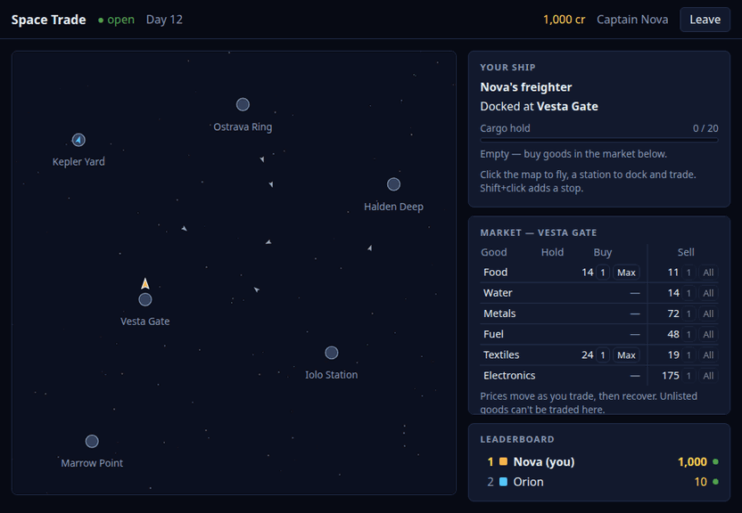

# Space Trade

A real-time multiplayer space-trading game for the browser. Fly between stations, trade goods for credits, and plunder AI traders with friends in one shared sector.



## Run it

You only need Docker.

```bash
docker compose up -d --build
```

Open http://localhost:8080, pick a name and play. Add `?slot=1`, `?slot=2`, … to the URL to play several players in one browser.

Stop with `docker compose down`. The world lives in memory, so every restart resets it.

## Play with friends on your network

```bash
./scripts/lan-url.sh
```

prints the address (`http://<your LAN IP>:8080`) friends type into their browser. If the browser warns that the connection is not secure, click "Continue to site".

## Tech stack

- Backend: Go 1.24 (`net/http` + `coder/websocket`), with the whole game state in memory
- Frontend: React 18 + Vite, with the map drawn in plain SVG
- nginx in front; everything runs in Docker Compose

## Development

```bash
docker compose logs -f backend   # rebuilds and compile errors
docker compose exec backend sh -c 'gofmt -l .; go vet ./... && go test ./...'
```

See `PLAN.md` for the roadmap and `docs/Architecture.md` for how it fits together.
